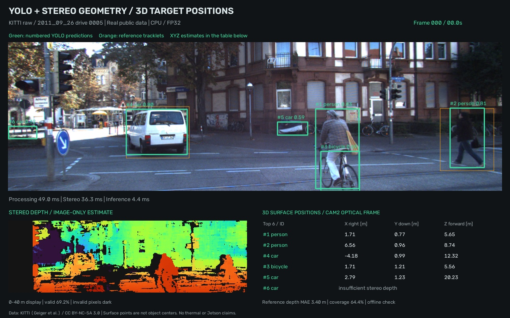
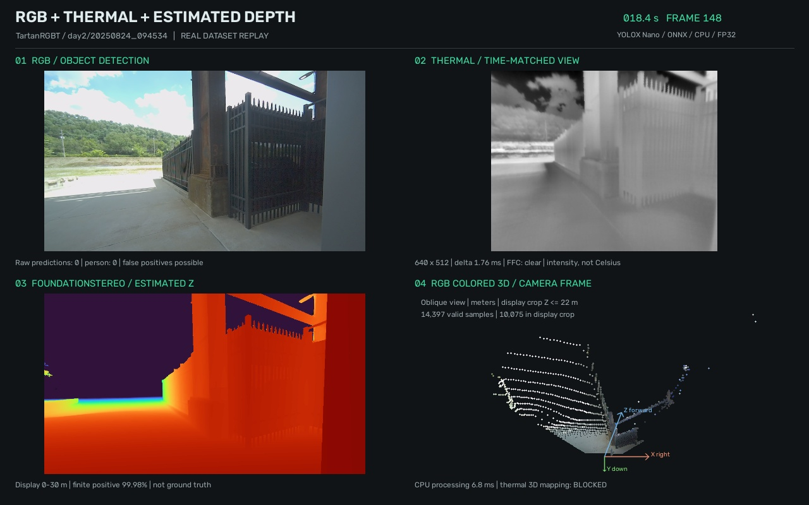
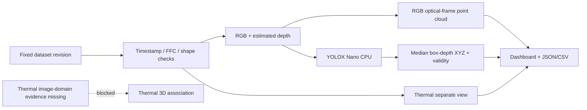

# AXG Multimodal Perception

项目目标是把几何视觉能力扩展到深度学习感知、连续输入处理、Jetson/TensorRT 部署，以及可复现的误差和性能验证。当前主线使用公开 KITTI 数据完成 **YOLO 检测 → 双目深度 → 三维表面代表位置 → 独立参考检查**。



当前 KITTI 演示：`results/kitti/axg_kitti_3d_demo.mp4`。完整说明与复现命令见 [KITTI 基线](docs/KITTI.md)，结果见 [本轮验收报告](reports/kitti_status.md)。

换电脑继续开发或部署 Jetson AGX，请从 [跨电脑接手与 Jetson 部署文档](JETSON_AGX_HANDOFF.md) 开始，包含迁移命令、设备环境分支、CPU 基线、TensorRT 待实现部分和可复制的 Codex 接手提示词。

- 154 帧真实连续数据；992 次检测输出，其中 976 次有三维位置。这些是跨帧输出次数，不是不同物体数。
- 初始 CPU 无界面基线：14.14 FPS，处理延迟 p95 59.34 ms。
- 受控 10 Hz 回放：154 帧全部完成，零丢帧；调度输入到输出的延迟 p95 74.18 ms。
- 双目深度相对原始 LiDAR：全部共同像素 MAE 1.857 m；匹配目标表面像素 MAE 0.955 m。参考像素覆盖率 76.98%。这些不是物体中心定位精度。
- 21 项测试在工作环境与干净环境通过。无界面、10 Hz、离线评估三种运行的逐帧输出摘要一致。

**Jetson/TensorRT 尚未实机验证；热像关联保留为单独扩展。完整项目尚未全部验收。**

先按下方 Setup 安装环境，再运行：

```powershell
.venv/Scripts/python.exe scripts/download_kitti.py
.venv/Scripts/python.exe scripts/download_model.py
.venv/Scripts/python.exe scripts/run_kitti.py
.venv/Scripts/python.exe scripts/run_kitti.py --paced --rate-hz 10 --drop-late --report reports/kitti_paced_10hz.json
```

## Earlier TartanRGBT baseline

此前的 RGB、热像、估计深度回放项目及其 296 组有效帧结果保留在下面，作为多模态时间配对和可视化基线。它与新 KITTI 流程使用不同的数据、深度来源和性能报告。



本地视频：`results/demo/axg_multimodal_demo.mp4`。上传方法见 [视频交付说明](docs/VIDEO.md)。数据、权重和视频不进入 Git 历史；预览图、代码与报告可进入仓库。

## What is implemented

- Selective, resumable download from a pinned Hugging Face revision, with file sizes and SHA-256 records.
- Sidecar-verified frame pairing, timestamp diagnostics, FFC exclusion, explicit shape/dtype validation.
- Rectified RGB backprojection, rigid transforms, frame/unit checks, box-depth medians and valid-point counts.
- YOLOX Nano ONNX CPU inference with documented BGR preprocessing and COCO class mapping.
- Synthetic-tested thermal z-buffer correspondence; disabled for this real release until its image domain is verified.
- Timestamp-paced or unpaced replay, bounded memory, JSON/CSV timings, four-view video, read-only Jetson probe.



## Setup

Use a normal Python 3.10+ installation, preferably Python 3.12. Do not use a Python bundled inside a graphics application. This machine's default `python` pointed to Inkscape; its `python3.12.exe` was used to create the isolated environment.

Windows PowerShell:

```powershell
python3.12.exe -m venv .venv
.venv/Scripts/python.exe -m pip install -e ".[test,download,detector]"
.venv/Scripts/python.exe -m pytest -q
.venv/Scripts/python.exe scripts/run_demo.py --smoke
```

Linux/macOS: create the environment with `python3 -m venv .venv` and replace `.venv/Scripts/python.exe` with `.venv/bin/python`. Those platforms have not been run here. On Jetson, inspect system compatibility first; do not install the PC lock file over JetPack packages.

`requirements-lock-pc.txt` records the actual PC package versions. The runtime needs NumPy, OpenCV and PyYAML; ONNX Runtime and Hugging Face Hub are optional dependency groups. FFmpeg/FFprobe are required only for MP4 encoding/validation. No CUDA is required for the current baseline.

## Reproduce the real sample

The selected sequence is `day2/undistorted_images_all_cameras_20250824_094534`, revision `23475c0fa9190154e6f1fd78f6b82b29f9d508a0`. Three modality ZIPs plus timestamps total 889,043,374 bytes; calibration and source documentation add only a small amount. Allow several GB for extracted data and temporary video.

```powershell
.venv/Scripts/python.exe scripts/download_sample.py --revision 23475c0fa9190154e6f1fd78f6b82b29f9d508a0 --sequence day2/undistorted_images_all_cameras_20250824_094534 --inspect-only
.venv/Scripts/python.exe scripts/download_sample.py --revision 23475c0fa9190154e6f1fd78f6b82b29f9d508a0 --sequence day2/undistorted_images_all_cameras_20250824_094534
.venv/Scripts/python.exe scripts/download_model.py
.venv/Scripts/python.exe scripts/inspect_dataset.py
.venv/Scripts/python.exe scripts/validate_calibration.py
```

One-command headless demo after setup/download:

```powershell
.venv/Scripts/python.exe scripts/run_demo.py
```

Use `--paced --show` for an interactive OpenCV dashboard at the source timestamps; Escape stops playback. The headless path and video renderer were executed. Manual GUI interaction has not been tested.

Create the video:

```powershell
.venv/Scripts/python.exe scripts/run_demo.py --video results/demo/demo_raw.avi --report reports/benchmark_render.json
.venv/Scripts/python.exe scripts/encode_video.py results/demo/demo_raw.avi results/demo/axg_multimodal_demo.mp4
```

## Measured PC baseline

Initial measured run: Windows 11, Python 3.12.10, 32 logical CPUs, ONNX Runtime CPU provider, 4 inference threads, batch 1, FP32, RGB 960×540, detector 416×416. An RTX 4080 SUPER was present but **not used**. Five warmup frames ran before timing; all 296 valid frames then ran again in the measured sequence.

| Quantity | Measurement |
| --- | ---: |
| Decoded source groups | 302 |
| Valid matched groups | 296 |
| FFC groups excluded | 6 |
| RGB–thermal timestamp offset p50 / p95 | 1.739 / 2.124 ms |
| Unpaced headless pipeline throughput | 64.32 frames/s |
| Processing latency p50 / p95 | 6.07 / 27.86 ms |
| Inference latency p50 / p95 | 4.38 / 5.55 ms |
| Total frame time including read/decode p95 | 34.82 ms |
| Raw detector predictions / person predictions | 20 / 3 |
| Detection mAP / independent 3D accuracy | Not measured |
| Jetson / TensorRT speedup | Not measured |

These are single-run observations, not guaranteed performance or optimized-vs-baseline speedups. Raw samples are in [benchmark_pc.csv](reports/benchmark_pc.csv), with [hardware, model hash and method](reports/benchmark_pc.json). The render and timestamp-paced runs have separate reports. Source timestamps have variable spacing despite the nominal 10 Hz release; see [dataset audit](reports/dataset_audit.json). The MP4 uses 10 fps presentation with held images for timestamp gaps.

Processing latency starts after frame loading and ends when detection and RGB-depth geometry are ready. Throughput includes read/decode and the selected rendering mode. None of these is physical camera-to-display latency. The reduced RGB-depth pipeline meets the 10 fps / 100 ms p95 processing design target in the unpaced run; this is **not** a claim that calibrated thermal fusion or Jetson passes that target.

## Scientific limits and failure behavior

- The detector visibly misclassifies metal gates as trains and emits unverified person predictions. Boxes and XYZ values are **model outputs**, not verified people/objects. A separate upstream sample sanity check detects a dog, bicycle and car, but it is not an accuracy evaluation.
- FoundationStereo depth is an estimate in meters, not independent ground truth. The audited range includes extreme values from about −3.89e9 to +2.71e9 m. Geometry rejects only nonfinite/nonpositive Z; it does not silently invent a physical range cutoff. Huge positive estimates remain in numerical cloud output. The video depth color range is 0–30 m; the 3D display crop is explicitly shown. Neither modifies raw depth.
- Object position is the componentwise median of finite positive points in the full RGB box. Background contamination is possible. Reports include valid point count, valid fraction and depth MAD; none is a calibrated confidence interval or body-center ground truth.
- Coordinates are `zed_left_camera_optical_frame`: X right, Y down, Z forward, meters. The released RGB K is used exactly as published. Generic image resizing uses the OpenCV half-pixel center convention.
- `configs/handheld.yaml` defines each TF as a child's pose in its parent. That pose is inverted to map RGB optical points into thermal optical coordinates. The CAD-based extrinsic is not an empirical registration accuracy measurement.
- The release calls 8-bit thermal images rectified, but its extraction config selects `/thermal_left/image_processed`; matching rectification code or CameraInfo P is absent from the checked source. Real thermal association is blocked. No raw equidistant distortion is applied to these pixels and no fitted homography conceals the uncertainty.
- Thermal 8-bit intensity is not Celsius. FFC groups and invalid synchronization groups are excluded. The 32 ms matching tolerance is an explicit selection policy derived from the release extraction tolerance.
- MID 3K evaluation and optional tracking were not enabled. No TartanRGBT mAP is reported without trusted labels.

## Evidence and deployment

See [phase status](reports/status.md), [decisions](reports/decision_log.md), [calibration evidence](reports/geometry_report.json), [results comparison](reports/comparison.md), and [Jetson access gate](docs/JETSON.md). The attachment kit is preserved in `docs/execution-kit/` as reference material; its phase-by-phase paste prompts are not treated as new user commands.

The implementation adds ingestion, geometry, model integration, audit, timing and rendering. It does not claim authorship of the dataset, FoundationStereo depth estimator, or YOLOX weights. Attribution, upstream licenses and citation are in [THIRD_PARTY.md](THIRD_PARTY.md). No repository has been created remotely, committed, or pushed.
