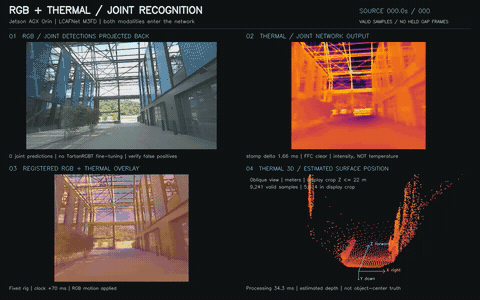

# Jetson Stereo Perception

**English** | [简体中文](README.zh-CN.md)

**RGB + thermal joint detection, geometric registration, and 3D position estimation** for TartanRGBT on **NVIDIA Jetson AGX Orin**. Geometrically aligned thermal images enter the LCAFNet dual-modality network alongside RGB and contribute to recognition. Outputs include bounding boxes, classes, confidence scores, valid surface XYZ estimates, and diagnostic videos.

The default FP32 configuration achieves **34.71 FPS**; the response-priority configuration achieves **24.11 FPS with p95 latency of 108.91 ms**. These measurements cover the complete replay pipeline, including rendering and H.264 encoding, using existing files and the dataset's published offline FoundationStereo depth estimates. Live camera acquisition and online depth inference are not implemented.

[Jetson deployment](docs/JETSON.md) · [Performance and latency](docs/BENCHMARKS.md) · [Architecture](docs/ARCHITECTURE.md) · [Development and releases](docs/DEVELOPMENT.md) · [Third-party notices](THIRD_PARTY.md)

Detailed deployment and architecture guides are in Chinese. Third-party notices are in English.

## Features

| Feature | Implementation and outputs |
| --- | --- |
| RGB + thermal joint recognition | LCAFNet M3FD receives aligned RGB and thermal inputs and predicts six classes: People, Car, Bus, Lamp, Motorcycle, Truck. Thermal data enters the network |
| Depth-assisted geometric registration | Backprojects RGB pixels using estimated depth, then projects them into the thermal image using fixed RGB/thermal extrinsics; handles occlusion and valid support |
| Fixed extrinsic refinement with scene BA | Uses constraints from multiple scene frames to optimize one shared set of extrinsics for the sequence; per-frame ECC is disabled by default, with calibration provenance and hashes retained |
| Time and motion compensation | Applies a +70 ms effective thermal timestamp correction for this sequence and estimates rigid rig motion with RGB optical flow/PnP; records fallback when compensation is unsupported |
| 3D surface position estimates | Computes XYZ statistics, depth support counts, and validity within detection boxes; returns an invalid status when depth support is insufficient |
| Invalid input handling | Checks timestamps, missing frames, depth, and thermal FFC; preserves all valid groups in source order and skips gaps/invalid groups in the video without holding the previous frame |
| Reproducible replay and diagnostics | Produces fused views, detection/position tables, H.264 videos, per-frame predictions, stage timing CSVs, and JSON summaries |
| Separate KITTI baseline | Retains RGB detection, StereoSGBM depth, and offline LiDAR/tracklet comparisons; see the [KITTI guide](docs/KITTI.md) |

Fixed RGB/thermal extrinsics describe the rig geometry. RGB motion estimates account for rig movement between exposure times. The +70 ms correction was inferred from image alignment in this sequence and must not be applied directly to other cameras or sequences.

## Jetson deployment optimizations

| Optimization | Implementation | Numerical and resource constraints |
| --- | --- | --- |
| TensorRT FP32 | Builds the engine on the target Jetson, disables TF32, reuses inference contexts, and uses CUDA Graph | Uses FP32 to preserve numerical consistency |
| Dense registration on GPU | CUDA handles dense projection, valid-point compaction, sampling, hole filling, and preprocessing for both inputs | Core geometry retains an FP64/no-FMA path, checked against the CPU reference |
| Memory reuse | Reuses GPU buffers, mapped page-locked host memory, and fixed input/output buffers | Reduces allocations and bulk copies while using Orin's shared physical memory |
| Candidate output compaction | Filters candidates above the threshold on GPU, then runs NMS and XYZ calculations on CPU | Does not change the candidate set through arbitrary top-K truncation |
| Parallel processing | Uses bounded CPU preparation queues, two GPU inference contexts, asynchronous rendering, and Jetson H.264 hardware encoding | Preserves valid frames in source order; throughput does not rely on frame dropping |
| Response latency reduction | Uses independent input dispatch, a two-group preparation prefetch and a one-frame render queue; response-priority mode uses one inference context and one prefetched group | Default p95 is 146.15 ms; response-priority p95 is 108.91 ms |
| Separate deployment environments | Uses a CPU PyTorch environment only for ONNX export and system TensorRT/CUDA for runtime | Runtime does not require PyTorch; engines, models, and calibration have metadata checks |

RGB optical flow/PnP, NMS, XYZ statistics, and some rendering run on CPU. See the [benchmark report](docs/BENCHMARKS.md) and [latency guide](docs/TARTAN_LATENCY.md) for numerical equivalence checks, scheduling parameters, and latency distributions.

## Demo videos

The previews below are looping GIFs covering the full 29.6-second demonstration at **480×300 / 5 FPS**. Full-resolution MP4s are included separately, approximately 7 MB each. Preview playback speed is independent of processing throughput.

| Default: balanced throughput and latency | Response priority |
| --- | --- |
|  |  |
| [Download balanced.mp4](docs/media/tartan-rgbt-balanced.mp4) | [Download responsive.mp4](docs/media/tartan-rgbt-responsive.mp4) |

Both full MP4 videos are **1280×800, H.264, 296 frames, 10 FPS, and 29.6 seconds long**. Playback FPS is independent of processing throughput. Of the 302 source groups, 6 invalid thermal FFC groups are explicitly excluded. All 296 valid groups are retained, without repeating the previous frame to fill time gaps. The videos therefore do not preserve the original acquisition duration. See [video provenance, checksums, and reproduction instructions](docs/VIDEO.md).

## Measured throughput and response latency

Tests ran on AGX Orin 64GB with L4T 36.4.7, CUDA 12.6, TensorRT 10.3, and Python 3.10.12. The two released profiles each include three complete runs, processing 296 valid groups per run and 1,776 groups overall. Percentiles pool 888 per-frame samples for each profile.

| Profile | Complete pipeline FPS | Per-run FPS range | Latency p50 | Latency p95 | Latency p99 |
| --- | ---: | ---: | ---: | ---: | ---: |
| **Default balanced** | **34.71** | **34.42–35.04** | **133.40 ms** | **146.15 ms** | **258.75 ms** |
| **Response-priority responsive** | **24.11** | **23.69–24.52** | **95.13 ms** | **108.91 ms** | **141.58 ms** |

FPS includes reading, decoding, motion estimation, GPU registration, joint inference, NMS/XYZ, rendering, encoding, and final encoder drain. Initialization and model warmup are excluded. Latency in the table is `input_to_output_ms`: from the start of preparation/disk reading for a group to completion of frame submission and associated output work, including snapshot saving on a few frames. The more precise p95 ending at encoder submission is **144.36 ms / 108.91 ms** for balanced / responsive. Camera-exposure-to-display latency has not been measured. Parallel execution means throughput and individual frame response time are different quantities.

See the [benchmark report](docs/BENCHMARKS.md) for hardware conditions, timing definitions, per-frame CSVs, and reproduction instructions.

## Deploy on Jetson AGX Orin

Run all commands from the repository root on the Jetson. The verified software environment is Ubuntu 22.04 / Python 3.10 / TensorRT 10.3. Other JetPack versions, AGX Xavier, and devices with different memory capacities require separate validation.

```bash
git clone https://github.com/RyanAnvie/jetson-stereo-perception.git
cd jetson-stereo-perception
python3 -m venv --system-site-packages .venv-jetson-trt
.venv-jetson-trt/bin/python -m pip install --upgrade pip setuptools wheel
.venv-jetson-trt/bin/python -m pip install -r requirements/jetson-runtime.txt
.venv-jetson-trt/bin/python -m pip install --no-deps -e .
export PYTHONPATH=src OPENBLAS_NUM_THREADS=1

# Download only the validated sequence and calibration, about 0.9 GB compressed.
.venv-jetson-trt/bin/python scripts/download_sample.py \
  --revision 23475c0fa9190154e6f1fd78f6b82b29f9d508a0 \
  --sequence day2/undistorted_images_all_cameras_20250824_094534
```

Next, follow the [complete deployment guide](docs/JETSON.md) to obtain the specified upstream LCAFNet weights, export ONNX in a separate CPU environment, and build an FP32 TensorRT engine on the target Jetson. Weights, ONNX files, engines, and raw data are not included in this repository. Model licensing is separate from the project's MIT license.

Once the model artifacts and their JSON metadata are ready:

```bash
# Process a five-frame sample.
.venv-jetson-trt/bin/python scripts/run_tartan_joint.py \
  --frames 5 --report reports/local/sample.json

# Default profile: complete processing with H.264 video output.
.venv-jetson-trt/bin/python scripts/run_tartan_joint.py \
  --video results/demo/balanced.mp4 --report reports/local/balanced.json

# Prioritize lower response latency.
.venv-jetson-trt/bin/python scripts/run_tartan_joint.py \
  --config configs/tartan_joint_responsive.yaml \
  --video results/demo/responsive.mp4 --report reports/local/responsive.json
```

Each run produces a JSON summary, a per-frame CSV, and an `.outputs.json` file. See the [configuration guide](configs/README.md).

## Result scope

All six runs of the two released profiles match the saved FP32 reference frame by frame, with 21 detections and 8 valid positions per sequence pass. **Numerical equivalence does not establish detection accuracy**: this sequence has neither a measured detection mAP nor complete registration ground truth. Limited manual edge observations cannot certify alignment accuracy across the full video. Motion compensation is accepted for 279 frames; 17 fall back because support is insufficient, with status recorded in the reports.

Depth is estimated. XYZ describes a representative visible surface position from valid points within a detection box, not an object center. Thermal images contain 8-bit grayscale intensity, not temperatures in degrees Celsius. The sequence-specific calibration correction has limited validation; new sequences require further checks.

## Repository layout and licensing

| Directory | Contents |
| --- | --- |
| `src/multimodal_perception/` | Registration, joint detection, scheduling, visualization, and the KITTI baseline |
| `configs/` | Default, response-priority, and CPU reference configurations; fixed calibration |
| `scripts/` | Download, export, build, run, validation, and packaging tools |
| `tests/` | CPU unit tests and optional Jetson/GPU integration tests |
| `docs/` | Deployment, architecture, development guides, and final demo videos |
| `reports/published/` | Published benchmarks, per-frame timings, and provenance checksums |
| `data/`, `models/weights/`, `results/` | Locally generated directories, ignored by Git |

Original project code is licensed under the [MIT License](LICENSE). TartanRGBT-derived videos and images retain their BSD-3-Clause-Clear attribution and notices. LCAFNet, YOLOX, KITTI, and dependencies retain their respective upstream terms; see [THIRD_PARTY.md](THIRD_PARTY.md).
