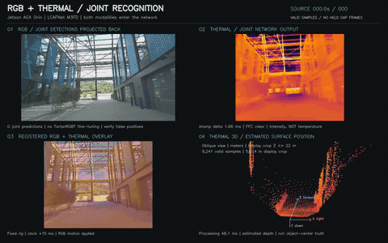

# Jetson Stereo Perception

[English](README.md) | **简体中文**

在 **NVIDIA Jetson AGX Orin** 上运行 TartanRGBT 的 **RGB + thermal 联合检测、几何配准和三维位置估计**。热像经过几何对齐后进入 LCAFNet 双模态网络，参与识别；输出检测框、类别、置信度、可用的表面 XYZ 和诊断视频。

默认 FP32 配置实测 **34.71 FPS**，响应优先配置 **24.11 FPS / p95 108.91 ms**。这是读取已有数据的完整回放处理性能，包含渲染和 H.264 编码，深度使用数据集发布的 FoundationStereo 离线估计。项目目前没有实时相机采集或在线深度网络。

[Jetson 部署](docs/JETSON.md) · [性能与延迟](docs/BENCHMARKS.md) · [处理架构](docs/ARCHITECTURE.md) · [开发与发布](docs/DEVELOPMENT.md) · [第三方许可](THIRD_PARTY.md)

## 已实现功能

| 功能 | 实现与输出 |
| --- | --- |
| RGB + thermal 联合识别 | LCAFNet M3FD 同时接收对齐后的 RGB 和热像，输出 People、Car、Bus、Lamp、Motorcycle、Truck 六类预测；热像实际进入网络 |
| 深度辅助几何配准 | RGB 像素结合估计深度反投影，通过固定 RGB/thermal 外参投影到热像平面；处理遮挡和有效支持范围 |
| 场景 BA 固定外参校正 | 用多个场景帧的约束优化一套全段共享外参，默认关闭逐帧 ECC，保留标定来源与文件哈希 |
| 时间与运动补偿 | 本序列采用有效热像时间修正 +70 ms，使用 RGB 光流/PnP 估计相机组的刚体运动；补偿失败时明确记录回退 |
| 目标表面三维位置 | 对检测框内有效深度点统计 XYZ、支持点数及有效性；深度不足时返回无效状态 |
| 无效输入管理 | 检查时间戳、缺帧、深度和热像 FFC；全部有效组保持顺序，视频跳过源空隙和无效组，不再用上一帧填充 |
| 可复现回放与诊断 | 生成融合画面、检测/位置表、H.264 视频、逐帧输出、阶段计时 CSV 和 JSON 汇总 |
| 独立 KITTI 基线 | 保留 RGB 检测、StereoSGBM 双目深度和离线 LiDAR/tracklet 对照，见 [KITTI 说明](docs/KITTI.md) |

两台相机之间固定，但整套相机相对场景运动，因此固定外参和跨时间运动补偿同时存在。+70 ms 是这段序列的图像对齐修正，不能直接套用到其他相机或序列。

## Jetson 部署优化

| 优化 | 具体做法 | 精度和资源约束 |
| --- | --- | --- |
| TensorRT FP32 | 在目标 Jetson 构建 engine，关闭 TF32，复用推理上下文，使用 CUDA Graph | 采用 FP32 保持推理数值一致性 |
| GPU 密集配准 | CUDA 完成密集投影、有效点压缩、采样、补洞及双路输入预处理 | 核心几何保留 FP64/no-FMA 路径，与 CPU 参考做数值对照 |
| 内存复用 | 复用 GPU 缓冲区、映射页锁定主机内存和固定输入/输出缓冲区 | 减少重复分配和大块数据复制；利用 Orin 共享物理内存 |
| 候选输出压缩 | 在 GPU 筛选达到阈值的候选，再由 CPU 完成 NMS 和 XYZ | 不使用任意 top-K 截断改变候选集合 |
| 并行处理 | 有界 CPU 准备队列、双 GPU 推理上下文、异步渲染和 Jetson H.264 硬件编码 | 全部有效帧保持顺序，不靠丢帧提高吞吐 |
| 响应延迟优化 | 独立输入调度，默认预取 2 组、渲染队列 1 帧；响应优先模式采用单推理上下文和单组预取 | 默认 p95 为 146.15 ms；响应优先为 108.91 ms |
| 部署环境分离 | CPU PyTorch 环境只负责 ONNX 导出，运行环境使用系统 TensorRT/CUDA | 运行不依赖 PyTorch；engine、模型、标定均有元数据校验 |

RGB 光流/PnP、NMS、XYZ 统计和部分渲染仍在 CPU。当前优化没有将所有处理迁到 GPU。数值等价检查、调度参数和尚存的延迟长尾见 [性能报告](docs/BENCHMARKS.md) 与 [延迟说明](docs/TARTAN_LATENCY.md)。

## 测试视频

下面是自动循环的 **GIF 预览**，覆盖完整 29.6 秒演示，预览规格为 **480×300 / 5 FPS**。完整高清 MP4 同时保留，每个约 7 MB。预览播放速度与处理吞吐不同。

| 默认：均衡吞吐与延迟 | 响应优先 |
| --- | --- |
|  |  |
| [下载 balanced.mp4](docs/media/tartan-rgbt-balanced.mp4) | [下载 responsive.mp4](docs/media/tartan-rgbt-responsive.mp4) |

完整 MP4 视频为 **1280×800、H.264、296 帧、10 FPS、29.6 秒**。播放帧率用于展示，与处理吞吐不同。302 组源数据中，6 组热像 FFC 无效输入被明确排除；全部 296 组有效输入均保留，没有用上一帧填充时间空隙。因此这不是保持原始采集时长的视频。[视频来源、校验和与复现方法](docs/VIDEO.md)。

## 实测速度与响应延迟

在 AGX Orin 64GB、L4T 36.4.7、CUDA 12.6、TensorRT 10.3、Python 3.10.12 上，发布的两种配置各包含 3 次完整运行。每次 296 组有效输入，共 1,776 组处理记录；每个配置的分位数合并 888 个逐帧样本计算。

| 配置 | 完整流程 FPS | 每次 FPS 范围 | 延迟 p50 | 延迟 p95 | 延迟 p99 |
| --- | ---: | ---: | ---: | ---: | ---: |
| **默认 balanced** | **34.71** | **34.42–35.04** | **133.40 ms** | **146.15 ms** | **258.75 ms** |
| **响应优先 responsive** | **24.11** | **23.69–24.52** | **95.13 ms** | **108.91 ms** | **141.58 ms** |

FPS 包含读取、解码、运动估计、GPU 配准、双模态推理、NMS/XYZ、渲染、编码及结束时排空编码器；不包含初始化和模型预热。表中延迟为每组开始准备/读盘到画面提交后处理结束的 `input_to_output_ms`，少量帧含保存截图。精确到编码器提交的 p95 为 **144.36 ms / 108.91 ms**；尚未测量相机曝光到显示的延迟。并行处理使吞吐与单帧响应时间不同。

硬件环境、计时定义、逐帧 CSV 和复现方法见 [性能报告](docs/BENCHMARKS.md)。

## 部署到 Jetson AGX Orin

以下命令均在 Jetson 的仓库根目录执行。已验证的软件环境是 Ubuntu 22.04 / Python 3.10 / TensorRT 10.3；其他 JetPack、AGX Xavier 或其他容量设备需要另测。

```bash
git clone https://github.com/RyanAnvie/jetson-stereo-perception.git
cd jetson-stereo-perception
python3 -m venv --system-site-packages .venv-jetson-trt
.venv-jetson-trt/bin/python -m pip install --upgrade pip setuptools wheel
.venv-jetson-trt/bin/python -m pip install -r requirements/jetson-runtime.txt
.venv-jetson-trt/bin/python -m pip install --no-deps -e .
export PYTHONPATH=src OPENBLAS_NUM_THREADS=1

# 只下载已验证的一个序列及其标定文件，约 0.9 GB 压缩数据。
.venv-jetson-trt/bin/python scripts/download_sample.py \
  --revision 23475c0fa9190154e6f1fd78f6b82b29f9d508a0 \
  --sequence day2/undistorted_images_all_cameras_20250824_094534
```

接着按 [完整部署说明](docs/JETSON.md) 从上游取得指定 LCAFNet 权重，在独立 CPU 环境导出 ONNX，再在目标 Jetson 构建 FP32 TensorRT engine。权重、ONNX、engine 和原始数据不包含在本仓库；模型许可独立于项目 MIT 许可。

模型及其 JSON 元数据就绪后：

```bash
# 5 帧检查；无视频时的 FPS 不能与完整视频基准直接比较。
.venv-jetson-trt/bin/python scripts/run_tartan_joint.py \
  --frames 5 --report reports/local/smoke.json

# 默认配置，完整处理并写入 H.264 视频。
.venv-jetson-trt/bin/python scripts/run_tartan_joint.py \
  --video results/demo/balanced.mp4 --report reports/local/balanced.json

# 优先降低响应延迟。
.venv-jetson-trt/bin/python scripts/run_tartan_joint.py \
  --config configs/tartan_joint_responsive.yaml \
  --video results/demo/responsive.mp4 --report reports/local/responsive.json
```

每次产生 JSON 汇总、逐帧 CSV 和 `.outputs.json`。配置详见 [configs/README.md](configs/README.md)。

## 验证范围与限制

两个发布配置的 6 次运行与保存的 FP32 参考结果逐帧一致，每遍序列共 21 个检测、8 个有效位置。**数值一致不代表识别准确**：没有这段数据的检测 mAP 或完整配准真值。有限人工边缘验证也不能作为全视频精度认证。279 帧接受运动补偿，17 帧因支持不足回退，状态写入报告。

深度是估计值，XYZ 是框内有效点的可见表面代表位置，不是目标中心。热像是 8 位灰度强度，不能当作摄氏温度。该序列的标定修正经过有限验证，新的数据序列需要重新检查。

## 目录与许可

| 目录 | 内容 |
| --- | --- |
| `src/multimodal_perception/` | 配准、联合检测、调度、可视化与 KITTI 基线 |
| `configs/` | 默认、响应优先、CPU 参考配置及固定标定 |
| `scripts/` | 下载、导出、构建、运行、验证、打包工具 |
| `tests/` | CPU 单元测试及可选 Jetson/GPU 集成测试 |
| `docs/` | 部署、架构、开发说明和最终视频 |
| `reports/published/` | 公开基准、逐帧计时和来源校验和 |
| `data/`、`models/weights/`、`results/` | 本地生成目录，Git 忽略 |

原创代码采用 [MIT License](LICENSE)。TartanRGBT 派生视频/图片保留 BSD-3-Clause-Clear 来源与声明；LCAFNet、YOLOX、KITTI 及依赖分别遵循其上游条款，见 [THIRD_PARTY.md](THIRD_PARTY.md)。
