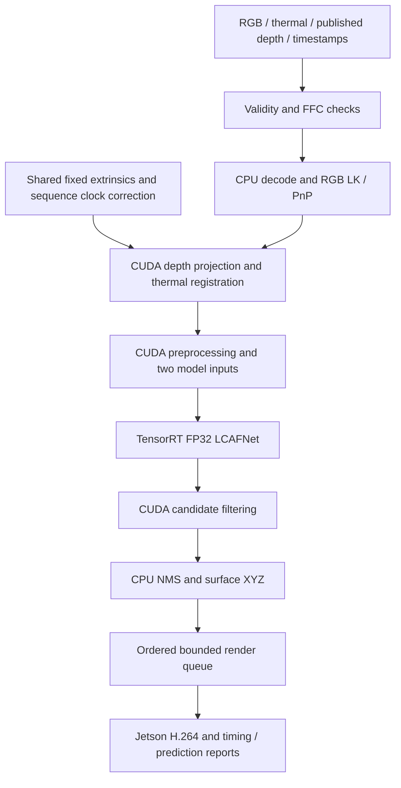

# 处理架构与配准假设

## 坐标、外参和运动

RGB 与 thermal 固连，外参在整段使用同一套矩阵。场景 BA 使用多个帧的场景线约束优化共享外参，当前固定修正的训练帧为 40、80、130、160、280；保留验证帧和有限人工边缘观测。优化在离线阶段执行，运行时加载 `configs/tartan_fixed_refinement.json`，不会每帧重新做 BA 或 ECC。

固定安装不代表相机组相对场景静止。RGB 和 thermal 的有效曝光时间不完全一致，移动相机看到的位置不同。运行时以 RGB 光流和深度支持的 PnP 估计相机组运动，再按有效时间差插值；这一步改变的是跨曝光时刻的位姿，固定外参不随帧漂移。

本序列的有效热像曝光时间为发布的 thermal timestamp + 0.07 s。这个数通过场景图像对齐诊断选取，未独立测量相机硬件时钟。刚性场景假设对动态目标可能失效；279 帧接受补偿，17 帧支持不足回退。运行状态和未补偿原因进入逐帧输出。

[时间诊断](../reports/published/tartan_fixed/clock_diagnosis.json) 和 [深度诊断](../reports/published/tartan_fixed/depth_diagnosis.json) 保留不同假设的证据。没有用逐帧热像平移去掩盖深度边界、遮挡和不同波段外观差异。更换相机、镜头、分辨率、数据序列或时间戳约定都要重新验证。

## 联合识别与几何位置

8 位热像在几何对齐后复制为 3 通道，与 RGB 分别居中 letterbox 到 640×640，输入 FP32、0–1。LCAFNet 在网络内融合两种模态特征。输出类序为 People、Car、Bus、Lamp、Motorcycle、Truck；默认分数阈值 0.25，NMS IoU 0.45。热像参与网络计算并不保证在所有场景提高准确率，本数据没有对应的完整检测标注。

检测框内的有效深度经反投影生成 XYZ，取代表性的表面统计量并记录支持度；深度不足则返回无效位置。XYZ 使用 RGB 光学相机坐标，米制，X 向右、Y 向下、Z 向前，不是世界坐标或物体中心。深度来自数据集发布的 FoundationStereo 估计，不是本项目在线运行 FoundationStereo。

## 性能实现

`cuda_registration.py` 在 GPU 上执行密集几何、采样、补洞和输入预处理；`tensorrt_inference.py` 管理 TensorRT、CUDA Graph 和复用缓冲区；`joint_workers.py` 与 `joint_prefetch.py` 控制并发和有界排队。映射页锁定缓冲区利用 Orin 共享物理内存，减少复制；仍需正确同步，不能认为所有阶段零复制。GPU 候选筛选保留阈值以上结果，不做任意 top-K 截断，CPU 完成 NMS 和位置统计。

`joint_pipeline.py` 保持有效输入的源顺序，独立调度避免在交付已完成结果前被下一个准备任务阻塞。`jetson_video.py` 通过 GStreamer 使用硬件 H.264，异步渲染队列受限为 1 帧。没有实现硬件相机接入、目标跟踪或世界坐标 SLAM。

## 无效帧与视频时间轴

源序列含 302 组，索引 296–301 为 FFC 无效组；其余 296 组按顺序处理。默认 `compact_valid` 视频只写有效组，不保持上一幅画面填满源时间空隙，也不插值生成虚构观测。报告仍保留源索引和时间戳。这解决的是演示中的重复等待画面，不会恢复原本缺失的传感器测量。
