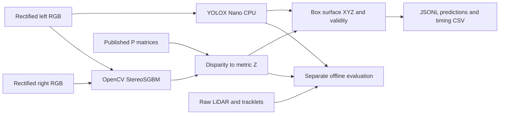

# YOLO + geometry: KITTI public-data baseline

This is the current development path for the user's four goals: combine learned detection with metric geometry, measure continuous-input behavior, prepare an identical-input Jetson/TensorRT comparison, and keep reproducible evidence. The existing TartanRGBT implementation remains available as a separate multimodal replay experiment.

## Data and inference

The input is KITTI raw `2011_09_26_drive_0005_sync`: 154 synchronized groups, RGB left/right `image_02`/`image_03`, original nanosecond timestamps, calibration and 15 annotated tracklets. The three official ZIPs total **646,299,418 bytes**. Archive identities and checksums are in `reports/kitti_download_manifest.json`. Dataset/derived-media license: CC BY-NC-SA 3.0; see `THIRD_PARTY.md`.

The inference path is deliberately explicit:



LiDAR and labels never enter `process_kitti_images`. Outputs contain class, score, box, original left/right timestamps, metric XYZ or `insufficient_depth`, valid point count/fraction and depth MAD. These are per-frame detections; no persistent object tracker or identity across frames is claimed.

## Reproduce

Use the project environment setup in the root README. No additional packages were introduced for this extension.

```powershell
.venv/Scripts/python.exe scripts/download_kitti.py
.venv/Scripts/python.exe scripts/download_model.py
.venv/Scripts/python.exe -m pytest -q

# RGB-only inference: no LiDAR decoding or label evaluation in the timed loop.
.venv/Scripts/python.exe scripts/run_kitti.py --report reports/kitti_benchmark.json

# Controlled arrival rate; preserves original source timestamps in outputs.
.venv/Scripts/python.exe scripts/run_kitti.py --paced --rate-hz 10 --drop-late --report reports/kitti_paced_10hz.json

# Deliberate overload to exercise the frame-drop path.
.venv/Scripts/python.exe scripts/run_kitti.py --paced --rate-hz 30 --drop-late --report reports/kitti_overload_30hz.json

# Native source timing instead of a controlled input rate.
.venv/Scripts/python.exe scripts/run_kitti.py --paced --report reports/kitti_source_paced.json

# Offline reference evaluation and rendered demo; not the live benchmark.
.venv/Scripts/python.exe scripts/run_kitti.py --mode evaluate --video results/kitti/kitti_raw.avi --report reports/kitti_evaluation.json
.venv/Scripts/python.exe scripts/encode_video.py results/kitti/kitti_raw.avi results/kitti/axg_kitti_3d_demo.mp4 --metadata reports/kitti_video_metadata.json
```

The native-source-timing command is supported but was not included in this round's measured runs. Use `--frames N` for a smaller smoke set. The downloader supports interrupted `.partial` transfers via HTTP Range, checks file sizes and records SHA-256. Subsequent completed downloads compare ETag/hash with the local manifest. Extraction retains all sensor measurements, including LiDAR reflectance. It refuses a selected transfer above 5 GB.

## Geometry definitions

Output coordinates are `kitti_cam2_rect`, in meters: X right, Y down, Z forward. This is the rectified left color camera, not the camera-0 reference frame, Velodyne frame or world frame.

The official development kit gives the image projection chain:

```text
image_homogeneous = P_rect_02 @ R_rect_00 @ T_cam0_from_velo @ point_velo_homogeneous
```

For each rectified camera, decompose `P_i = K_i [I | t_i]`, with `t_i = inv(K_i) @ P_i[:,3]`. The implementation preserves **all three** translation components. The color stereo x baseline is 0.5327119288 m. It does not reuse TartanRGBT intrinsics or apply distortion again.

StereoSGBM produces signed disparity in sixteenths of a pixel; the implementation divides by 16. To preserve the small fourth-column terms, it solves the two horizontal projection equations for camera-0 Z, then adds the left camera's z translation. The resulting Z works with ordinary left-camera pinhole backprojection. Synthetic projection tests exercise nonzero x/y/z translation rather than only the simplified zero-offset case.

Stereo matching uses already rectified horizontal scanlines. The tiny residual vertical projection offsets in the published P matrices are retained for LiDAR/label projection; horizontal stereo matching does not further vertically rewarp the images. That limitation is part of this classical baseline.

All matcher settings are editable in `configs/kitti.yaml`: 128 disparities, block size 5, uniqueness ratio 10, speckle filtering, disparity consistency check, and SGBM 3-way mode. P1/P2 follow OpenCV's channel/block-size rule. They are algorithm parameters, not documented sensor limits. Derived depth invalidates nonpositive/nonfinite solutions. Input measurements are never overwritten or rescaled.

A detection position is the componentwise median of finite positive stereo points inside its predicted box. It is a **visible-surface representative**, which can include background. It is not an estimated 3D box center, body center or ground-contact point. Tracklet coordinates specify a bottom-center origin and cannot be compared directly to that median as if both meant the same location.

## What the reference metrics mean

1. Transform raw LiDAR XYZ into `kitti_cam2_rect` and project into the RGB image. Keep original scan indices/reflectance. At rounded pixel collisions retain the nearest positive Z.
2. Sample stereo depth at those pixels. Report coverage and invalid estimates separately; calculate signed Z differences only at common valid pixels. No depth cap or error/outlier rejection is applied to the aggregate metrics.
3. For object-level diagnostics, project raw tracklet cuboids and associate predictions greedily by descending IoU, one-to-one, threshold 0.5. Mapping is explicit: `Car -> car`, `Van -> car`, `Pedestrian -> person`. Fully occluded, unknown-occlusion, truncated and unsupported classes are excluded from this diagnostic subset; they remain in the source data.
4. Restrict the object-surface reference subset to LiDAR points inside the matched cuboid and predicted RGB box. Compare stereo and LiDAR **at the same pixels**. This GT-supported selection happens only offline, not in predicted positions. Counts, per-object coverage and errors are saved.

Reported MAE/RMSE, signed bias, median and p95 absolute error are computed from individual common-pixel samples, not an average of frame percentiles. Distance bins `[0,10)`, `[10,20)`, `[20,40)`, `[40,+inf)` are reporting categories only. No official KITTI mAP, detection precision/recall or object-center accuracy is claimed: raw projected tracklets are not a complete set of 2D detection annotations.

The raw rotating LiDAR is an independent sensor reference, with limitations: scans span about 103 ms, camera-to-scan timestamp difference is about 10.5 ms, and this baseline does not compensate scan motion or moving-object deformation. Calibration, occlusion and nearest-pixel rounding also affect differences. These measurements are therefore **stereo-versus-raw-LiDAR discrepancies**, not a certified physical localization accuracy.

## Continuous-input behavior

The source rate in this sequence is about 9.684 Hz. `--rate-hz 10 --paced` creates a separate 10 Hz replay schedule while preserving original capture timestamps. It is a controlled arrival-rate test, not a change to source synchronization and not a camera acquisition latency measurement.

The runner processes one frame at a time without a decoded-frame queue. With `--drop-late`, it selects the newest source index already due on the replay clock, records every skipped index, then processes that frame. Without it, all frames are retained and lateness can accumulate. Tests cover late arrivals, exact schedule boundaries and no-drop behavior. Output JSONL is written incrementally. Offline evaluation retains error vectors for exact aggregate percentiles and therefore uses more memory than the inference loop.

Five warmup frames run before each timer and are then included again in the timed sequence. Processing latency excludes I/O, offline reference work, rendering and encoding. Replay completion latency includes load/decode and scheduling lateness. Throughput uses completed frames divided by measured wall time, including waits or selected offline work. Dropped frames are reported separately and do not inflate completed-frame FPS.

## Evidence and remaining work

See `reports/kitti_status.md` and `reports/kitti_comparison.md`, raw CSV timing samples, JSONL outputs, `kitti_evaluation_errors.json`, and `kitti_dataset_audit.json`. The unpaced, controlled-10-Hz and offline-evaluation runs produce identical output content digests on all 154 frames.

The current CPU bottleneck is stereo matching, not YOLO inference. Converting the detector alone to TensorRT will not establish an equivalent end-to-end speedup. On an authorized Jetson, first inspect JetPack/TensorRT, run the exact same sequence/preprocessing, compare model and XYZ outputs, then profile each stage. No Jetson or TensorRT result has been fabricated. Long-duration soak testing, motion-compensated reference comparison, better object masks and held-out sequence evaluation remain future work.
